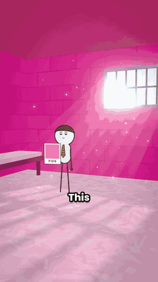

<!--
  Faceless YouTube Shorts 3D (faceless-youtube-shorts-3d): a free, open-source Claude Code skill that writes,
  animates and renders faceless 3D cartoon YouTube Shorts, TikToks and Instagram Reels with three.js and HyperFrames.
  AI cartoon video generator, story-to-animation director, word-by-word captions, toon shading, anime outline shader.
-->



<h1 align="center">Faceless YouTube Shorts 3D</h1>

<p align="center">
  <b>A free Claude Code skill that turns an idea into a faceless 3D cartoon YouTube Short.</b><br />
  Claude researches the story, writes the script, builds the scenes in three.js and renders a 30 to 40 second vertical video. You bring the voice.
</p>

<p align="center">
  <a href="#see-it-in-action">Demo</a> ·
  <a href="#how-it-works">How it works</a> ·
  <a href="#install">Install</a> ·
  <a href="#make-your-first-short">Usage</a> ·
  <a href="#whats-in-the-repo">Repo map</a> ·
  <a href="#the-style-measured">The style</a> ·
  <a href="#faq">FAQ</a>
</p>

<p align="center">
  <a href="https://claude.com/product/claude-code"></a>
  <a href="https://threejs.org"></a>
  <a href="https://github.com/heygen-com/hyperframes"></a>
  
  
  
  <a href="https://github.com/MadhavendraSinghShaktawat/faceless-youtube-shorts-3d/stargazers"></a>
</p>

**Faceless YouTube Shorts 3D is an AI cartoon video director that runs inside [Claude Code](https://claude.com/product/claude-code) as a skill.** Type `/faceless` plus a topic, and Claude takes it from a blank page to a finished `final.mp4`: ink-outlined stick characters with round white heads acting out a strange true story in a stylised 3D world, with a camera that never stops, word-by-word captions, music and sound effects.

There is no app and no UI. You clone one folder, then talk to Claude.

- **Story research.** Give it a topic and Claude finds three to five true stories that fit a proven hook, checks each against two sources and lets you pick.
- **Script writing.** A 104 to 150 word script timed for 30 to 40 seconds of voice, which you approve before anything is built.
- **Your voice, never a generated one.** Claude asks you to record the voiceover, then times every pose, cut and caption to your real words.
- **3D scenes in code.** Characters, sets, lights, camera moves and effects written as a three.js scene, rendered headless by HyperFrames.
- **Captions and audio mix.** Word-by-word captions in the classic Shorts style, music and effects from free libraries, mastered to −14 LUFS.
- **Self-review and cleanup.** Claude checks stills and contact sheets of its own render before handing it over, then deletes the temporary files.

Made for **faceless YouTube Shorts, TikTok and Instagram Reels** channels, storytellers and anyone who wants cartoon explainers without drawing a frame.

## See it in action

This clip was rendered by the engine in this repo: 240 frames at 1080×1920 in 6.7 seconds on an Apple Silicon laptop, every check passed. It is silent because no voiceover was supplied.

<p align="center">
  
</p>

<p align="center"><sub>Source: <a href="videos/_demo/video.js"><code>videos/_demo/video.js</code></a> · the GIF is downscaled; the real render is a full-quality 1080×1920 MP4.</sub></p>

## How it works



1. **Idea.** You give a topic ("medieval siege tricks"), a category or a finished idea. Claude researches real stories and offers hooks.
2. **Script.** Claude writes to a measured template: an unnamed "he" or "they" doing something that looks pointless, explained in under 40 seconds, ending on an ironic line. **You approve it.**
3. **Voiceover.** **You record or generate it** and drop the file in `videos/<slug>/audio/`. Claude never generates audio.
4. **Shot plan and assets.** Your voice is transcribed for word timings; Claude plans 10 to 14 setups and pulls free models, textures, music and effects.
5. **Render.** Claude writes `video.js`, checks stills of every shot, then renders the full video.
6. **Deliver.** `out/final.mp4`, a credits file, a report of every check, and temporary files removed.

The whole procedure lives in [`SKILL.md`](SKILL.md). Claude reads it when the skill triggers.

## Install



You need [Claude Code](https://claude.com/product/claude-code), **Node.js 22 or newer**, **ffmpeg** (with ffprobe) and **Python 3** with Pillow.

```bash
# 1. clone into your personal skills folder (works in every project)
git clone https://github.com/MadhavendraSinghShaktawat/faceless-youtube-shorts-3d.git ~/.claude/skills/faceless-youtube-shorts-3d

# 2. install the render engine
cd ~/.claude/skills/faceless-youtube-shorts-3d && (cd engine && npm ci)

# 3. prove your machine can render (writes videos/_demo/out/final.mp4)
node engine/render.mjs videos/_demo
```

The skill is named `faceless`, so in Claude Code you start it with `/faceless`. To install it for one project only, clone into `.claude/skills/faceless-youtube-shorts-3d` inside that project instead.

<details>
<summary><b>Install ffmpeg and Pillow</b></summary>
<br />

```bash
# macOS
brew install node ffmpeg
python3 -m pip install pillow

# Ubuntu / Debian
sudo apt install ffmpeg python3-pip
python3 -m pip install pillow
```

</details>

<details>
<summary><b>What downloads on first use</b></summary>
<br />

| When | What | Size |
| --- | --- | --- |
| `npm ci` | three.js, HyperFrames and their dependencies | about 140 MB |
| First render | Headless Chrome, used by HyperFrames | about 193 MB |
| First transcription | Local Whisper speech model for word timings | about 488 MB |

Everything runs on your machine. Rendering uses the GPU when one is available; without one it is 5 to 9 times slower.

</details>

Or skip the typing and ask Claude: *"clone https://github.com/MadhavendraSinghShaktawat/faceless-youtube-shorts-3d into ~/.claude/skills/faceless-youtube-shorts-3d and set it up."*

## Make your first Short

Start Claude Code anywhere and type `/faceless` with a topic:

```text
/faceless make one about a weird medieval siege trick
/faceless the man who sold the Eiffel Tower, twice
/faceless find me 5 strange true prison stories
```

Claude stops for you three times: to pick the story, to approve the script and to supply the voiceover. Everything else (timing, shot plan, assets, scene code, render, review and cleanup) runs on its own. The finished video lands in `videos/<slug>/out/final.mp4`.

Useful commands while it works, or on your own:

```bash
node engine/render.mjs videos/<slug> --snap 0,1.5,3.0   # stills only, 2 to 4 s
node engine/render.mjs videos/<slug> --draft            # quick full pass
node engine/render.mjs videos/<slug>                    # final render and report
tools/cleanup.sh videos/<slug>                          # delete temporary files
```

## What's in the repo



| Path | What it holds |
| --- | --- |
| [`SKILL.md`](SKILL.md) | The director: ground rules, the 13-step workflow with its stop-and-ask points, quality gates |
| [`skills/`](skills/) | 14 craft guides: [context](skills/context.md), [script](skills/script.md), [characters](skills/characters.md), [outlines](skills/outlines.md), [textures](skills/textures.md), [lighting](skills/lighting.md), [depth](skills/depth.md), [motion](skills/motion.md), [camera](skills/camera.md), [captions](skills/captions.md), [audio](skills/audio.md), [assets](skills/assets.md), [render](skills/render.md), [cleanup](skills/cleanup.md) |
| [`engine/`](engine/) | The renderer: three.js scene kit (characters, poses, faces, sets, camera paths, dissolves, light shafts, captions), audio mastering and one render command. [`engine/README.md`](engine/README.md) is the full API |
| [`videos/`](videos/) | One folder per Short: `video.js`, `words.json`, your audio, `out/final.mp4`. `_demo` is a working example |
| [`reference/`](reference/) | Contact sheets with per-frame metadata and the measured analysis the style was built from |
| [`research/`](research/) | Render-stack benchmark, the anime outline shader study, three.js technique notes and catalogues of free assets |
| [`tools/`](tools/) | `make_sheets.py` turns any video into timestamped contact sheets; `cleanup.sh` removes render leftovers |

## The style, measured



The look was not described from memory. Three reference Shorts were cut into frames and read at 10 fps from start to end, and at 30 fps on every scene change and effect. The audio was measured with loudness and spectral tools. Every rule in `skills/` is tagged as measured, seen, a choice, or unknown.

<details>
<summary><b>The numbers the engine follows</b></summary>
<br />

| Area | Rule |
| --- | --- |
| Camera | Moving on every frame. Each shot starts with its move already running |
| Scene joins | Dissolves of 4 to 12 frames with both shots moving; hard cuts only when the story calls for it |
| Characters | 3 to 4 heads tall, round off-white head, single-stroke limbs, identity from one hat, hairstyle or costume colour |
| Animation | Two clocks: camera and world at a smooth 30 fps, characters on held poses of 2 to 15 frames that swap in one frame. Talking mouths flip every 2 to 3 frames |
| Outline | Inverted-hull ink line in dark plum (#2c1821), 3 to 7 % of head diameter, on characters only |
| Shading | Three-band toon shading, flattened textures, light shafts, bloom and soft depth of field |
| Captions | 1 to 3 words per card (mostly one), white with a black stroke, centred at 70 % height, hard swap with no animation |
| Script | About 3.65 words per second: 104 to 112 words for 30 s, 139 to 150 for 40 s. Hook inside the first 3.5 s, one exact number repeated, ironic last line |
| Audio | Music under the whole video, 22 to 25 dB below the voice, no ducking. 3 to 6 strong effects per 10 s. Master at −14 LUFS, true peak at or below −1 dBTP |

Details and evidence: [`skills/context.md`](skills/context.md) and [`reference/README.md`](reference/README.md).

</details>

## Tech stack

| Part | Choice |
| --- | --- |
| 3D | [three.js](https://threejs.org) 0.187.0. Every frame is a pure function of time, so renders are deterministic |
| Render host | [HyperFrames](https://github.com/heygen-com/hyperframes) 0.9.41 (Apache-2.0), headless Chrome to MP4 |
| Outline | Inverted-hull anime outline with toon shading, after [this tutorial](https://www.youtube.com/watch?v=V5UllFImvoE) |
| Captions | DOM overlay rendered in the same page, so text stays sharp |
| Audio | ffmpeg master pass to −14 LUFS; local Whisper for word timings |

<details>
<summary><b>Why HyperFrames and not Remotion</b></summary>
<br />

The same 1080×1920 toon scene with outlines, shadows and bloom was rendered in each host on an Apple Silicon laptop:

| Host | 5 s video | 40 s video |
| --- | --- | --- |
| Puppeteer + WebCodecs (no framework) | 1.35 s | 6.65 s |
| Remotion, best flags | 2.95 s | 9.2 s |
| HyperFrames, `--gpu` | 3.87 s | 12.9 s |

Remotion was a little faster, but its licence is free only for individuals and companies of up to three people. HyperFrames is free for everyone, and all three finish a 40 second Short in under 20 seconds. Full write-up: [`research/render-stack.md`](research/render-stack.md).

</details>

## Free 3D assets

Only free models, textures, music and effects are used, and every video gets a `CREDITS.md`. The catalogues in [`research/`](research/) list 326 checked assets plus every free file on freestylized.com and the 1,726 models of a Sketchfab stylised-world collection.

<details>
<summary><b>Sources and how they download</b></summary>
<br />

| Source | Used for | Download |
| --- | --- | --- |
| [freestylized.com](https://freestylized.com) | Stylised textures, painted skies, props | Command line, no login |
| [Stylized World](https://stylizedworld.com) | Stylised textures | Manual, free account |
| [Sketchfab](https://sketchfab.com) stylised collection | Models and environments | Free API token; CC BY and CC0 only |
| [Kenney](https://kenney.nl), [KayKit](https://github.com/KayKit-Game-Assets), [Quaternius](https://quaternius.com), [Poly Pizza](https://poly.pizza) | Low-poly kits and props | Command line, CC0 |
| [Poly Haven](https://polyhaven.com), [ambientCG](https://ambientcg.com) | Textures and HDRIs | Command line, CC0 |
| [Incompetech](https://incompetech.com), [Mixkit](https://mixkit.co) | Music and sound effects | Command line |

When nothing fits, Claude builds the prop from primitives: the style's sets carry no outlines, so simple shapes blend in. Rules and commands: [`skills/assets.md`](skills/assets.md).

</details>

## FAQ

<details>
<summary><b>What is Faceless YouTube Shorts 3D?</b></summary>
<br />

A Claude Code skill: a folder of instructions, a render engine and reference material that Claude loads when you type `/faceless`, or when you ask for a faceless cartoon Short in plain words. It directs and renders short vertical cartoon videos in one consistent style, built from a frame-by-frame study of three viral Shorts.

</details>

<details>
<summary><b>Is it free?</b></summary>
<br />

The skill and every tool in the stack are free and open source, and it only uses free assets. You need your own Claude Code plan to run Claude.

</details>

<details>
<summary><b>Does it generate the voiceover or music?</b></summary>
<br />

No. The voiceover always comes from you: record it yourself or use any voice tool you like, then drop the file in the video folder. Music and effects come from free libraries or from you. Nothing is AI-generated audio.

</details>

<details>
<summary><b>Which platforms is the video for?</b></summary>
<br />

The output is a 1080×1920, 30 fps H.264 MP4 at −14 LUFS, ready for YouTube Shorts, TikTok and Instagram Reels.

</details>

<details>
<summary><b>How long does a render take?</b></summary>
<br />

The 8 second demo renders in 6 to 10 seconds and a 36 second video in about 17 seconds on an Apple Silicon laptop with a GPU. The longer part is the conversation: research, script approval and recording your voice.

</details>

<details>
<summary><b>Can I bring my own idea or script?</b></summary>
<br />

Yes. Give Claude the idea and it checks the facts, saying what is documented and what is embellished, before writing. Scripts are capped at 30 to 40 seconds unless you say otherwise.

</details>

<details>
<summary><b>What does it not do yet?</b></summary>
<br />

The demo's characters, line weight and captions are close to the references; its sets are plainer, and richer sets are set dressing per video. Not built yet: the camera travelling through a wall into the next set, rain, cloth, crowds and hand rotation. Characters are unlit, and GLB animation playback has not been exercised in a render. It has been tested on macOS with Apple Silicon; Linux should work, and Windows is untested. The full list is at the end of [`engine/README.md`](engine/README.md).

</details>

<details>
<summary><b>Where did the style come from?</b></summary>
<br />

From three reference Shorts by another creator, studied frame by frame. The repo keeps the measured analysis and low-resolution study sheets in `reference/`, not the videos. This project is not affiliated with that creator or with Anthropic.

</details>

<details>
<summary><b>How do I free disk space?</b></summary>
<br />

`tools/cleanup.sh videos/<slug>` removes one video's build files and render history; Claude runs it after every delivery. `tools/cleanup.sh --deep` also removes `engine/node_modules`, the downloaded Chrome and the speech model. The Chrome and model cache in `~/.cache/hyperframes` is shared with any other HyperFrames project on your machine. Use `--dry-run` to see sizes first.

</details>

## Contributing

Issues and pull requests are welcome, especially new set pieces, character costumes, effects (rain, crowds, push-through joins) and Linux or Windows testing. Run `node engine/render.mjs videos/_demo` before opening a pull request and include the last lines of its output.

## Star history

<a href="https://www.star-history.com/#MadhavendraSinghShaktawat/faceless-youtube-shorts-3d&Date">
  <picture>
    <source media="(prefers-color-scheme: dark)" srcset="https://api.star-history.com/svg?repos=MadhavendraSinghShaktawat/faceless-youtube-shorts-3d&type=Date&theme=dark" />
    <source media="(prefers-color-scheme: light)" srcset="https://api.star-history.com/svg?repos=MadhavendraSinghShaktawat/faceless-youtube-shorts-3d&type=Date" />
    
  </picture>
</a>


